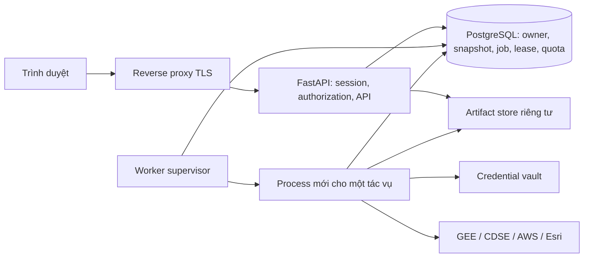

# Thiết kế refactor GEE_testing cho nhiều người dùng

**Ngày:** 2026-11-12. **Trạng thái:** Đề xuất để review; chưa triển khai.

## 1. Yêu cầu đã xác nhận và các lựa chọn đề xuất

Người dùng yêu cầu lập kế hoạch refactor toàn codebase, ưu tiên chuẩn hóa để
triển khai nhiều người dùng; **mỗi người kết nối tài khoản GEE/CDSE riêng**.
Lượt này chỉ tạo tài liệu. Không thay đổi mã sản phẩm, dependency, dữ liệu,
branch, tiến trình đang chạy hoặc credentials để thực hiện thiết kế này.

Các quyết định sau là đề xuất kỹ thuật, chưa phải yêu cầu đã được người dùng chốt:

- Giữ FastAPI và giao diện Leaflet/JavaScript hiện tại; tách module từng bước.
- Hai profile: `local` giữ cách dùng hiện tại; `server` bắt buộc đăng nhập,
  quyền sở hữu tài nguyên và worker tách biệt. Không tự nhận diện profile từ IP.
- Bản triển khai đầu tiên: một máy chủ, PostgreSQL 16, reverse proxy TLS,
  API và worker chạy container riêng. Ubuntu 24.04 LTS là môi trường nghiệm thu
  server đề xuất; Windows vẫn là môi trường local cần giữ hồi quy.
- Dùng PostgreSQL làm hàng đợi có lease; chưa thêm Redis, Celery, Kubernetes,
  object storage hoặc dịch vụ microservice.
- Đăng nhập ứng dụng qua OIDC; kết nối GEE/CDSE là các luồng riêng. Nhà cung cấp
  OIDC và thông tin đăng ký OAuth được xác minh ở R02 trước khi triển khai auth.
- Mặc định thử nghiệm: 10 phiên hoạt động, tối đa 2 tác vụ xử lý toàn hệ thống,
  tối đa 1 tác vụ chạy và 5 tác vụ chờ/người. Đây là cấu hình khởi điểm để đo,
  **không phải cam kết hiệu năng hoặc quy mô đã kiểm chứng**.

## 2. Hiện trạng đã kiểm tra tại checkout

Branch `feature/eodag-catalog-mvp`, HEAD `7e6ec12`; working tree có nhiều file
đã sửa và chưa tracked, gồm tính năng đồng khung, S5P và chọn lớp phụ S2.
Không được coi HEAD là toàn bộ sản phẩm đang dùng hoặc dùng `git add .` để
gom toàn bộ thay đổi làm baseline.

| Bằng chứng nguồn | Ý nghĩa cho refactor |
|---|---|
| `app/main.py`: 2.788 dòng, 59 hàm top-level, 7 class | Trộn cấu hình, model, API, provider, xử lý raster và vòng đời service |
| `app/imagery.py`: 1.729 dòng; `app/cdse.py`: 991 dòng | Cần tách xử lý ảnh khỏi transport/credentials, giữ facade tương thích |
| OpenAPI hiện tại: 56 operation, gồm 11 operation đồng khung | Kiểm kê qua OpenAPI; duyệt riêng `APIRoute` bỏ sót included router ở phiên bản FastAPI đang cài |
| `app/main.py:_lifespan`, `_timeseries_service`, `_frame_service`, `_esri_service` | Store/service toàn cục; startup recovery/cleanup của từng API process không phù hợp nhiều replica |
| `app/ee_session.py:init_ee`, `_initialized`; `app/frame_search.py:_RPC` đọc EE state | Cấu hình GEE ở cấp tiến trình; không thể đổi tài khoản bằng `ee.Initialize` trong request/thread dùng chung |
| `app/cdse.py:_token`, `get_token`, `get_s3_credentials` | Token/cấu hình tài khoản dùng chung, chưa có định danh người sở hữu |
| `TimeSeriesStore`, `FrameStore`, `EsriService` | SQLite/JSON và ID tài nguyên chưa chứa owner; lock/lease một phần chỉ trong process |
| `FrameStore.recover`, `TimeSeriesStore.recover_interrupted_jobs`, `EsriService.recover` | Recovery có thể đánh dấu job đang chạy ở process khác thành interrupted nếu mở nhiều API process |
| `FrameStore.lease`, `LeasedFileResponse` | Bảo vệ tải file hiện tại cần mở rộng thành lease chia sẻ giữa process trước khi chạy cleanup chung |
| `app/main.py`: CORS `*`; chưa thấy session/principal/owner authorization | Xác thực và cô lập người dùng là khả năng mới, không chỉ chuyển file |
| `app/scene_catalog.py`, `app/s5p.py`: import ngược `main` | Coupling vào module bootstrap; khó khởi tạo nhiều app độc lập trong test |
| `static/index.html`: 2.137 dòng; `static/matched-frame.js`: 790 dòng | Tách điều phối request, kết quả, trạng thái và xác thực; giữ luồng bản đồ hiện có |
| `frontend/src` chỉ có `api.ts`, `types.ts`; cấu hình trỏ `/api/analysis` | Scaffold NDVI chưa phải frontend đầy đủ; không dùng làm lý do ép chuyển toàn UI sang React |

Các số dòng là snapshot khảo sát, không phải tiêu chí nghiệm thu thiết kế.
Baseline test mới được ghi ở kế hoạch triển khai; mock/offline không chứng minh
OAuth thật, tải provider thật, concurrency liên tiến trình hoặc server acceptance.

## 3. Phương án cân nhắc

| Phương án | Ưu điểm | Đổi lại | Đề xuất |
|---|---|---|---|
| FastAPI theo module + PostgreSQL + worker độc lập, process riêng/tác vụ | Giữ kernel raster, cô lập EE global state, có đường mở rộng worker | Thêm DB, auth, queue và migration có kiểm chứng | Chọn cho bản nháp này |
| Mỗi người một bản ứng dụng/container và bộ dữ liệu riêng | Cô lập mạnh, tận dụng local profile | Tốn tài nguyên và quản trị; khó dashboard/quota chung, không giải quyết cấu trúc mã | Chỉ dùng nếu chính sách triển khai yêu cầu cách ly toàn ứng dụng |
| Microservices + broker + distributed object storage ngay từ đầu | Có thể scale từng dịch vụ | Tăng số failure mode, chưa có số đo/tải để biện minh | Hoãn tới khi vượt giới hạn một máy chủ đã đo |

## 4. Hợp đồng phải giữ

1. Profile local giữ URL/method/request/response, tên file và hành vi provider hiện có;
   các thay đổi giao thức server đi qua `/api/v2`, không âm thầm đổi nghĩa API cũ.
2. Giữ ROI điểm/chữ nhật/tỉnh/xã/khung mẫu, rotation, CRS, affine, kích thước,
   mask, zero hợp lệ, band order, scale/offset, NoData và resampling từng workflow.
3. S2 thường/time series giữ `s2_auxiliary_bands=None` = 26 band; `[]` = 12 băng phổ;
   tập con lớp phụ xuất theo thứ tự chuẩn. Matched-frame giữ preset riêng hiện có.
4. Không dùng một chính sách scale/NoData/SAR cho mọi nguồn. Phải so với fixture
   từng workflow, không suy ra giá trị đúng từ shape hoặc thống kê coverage.
5. Giữ immutable search, exact scene identity, platform, inclusive end date,
   pagination/truncation, danh sách ngày/cảnh mosaic, preflight digest và quality gates.
6. Giữ EODAG optional/default-off và catalogue-only; không tự thêm download,
   quicklook hoặc fallback provider. Giữ S3 CDSE pre-provisioned, không tự tạo key.
7. Không cập nhật/ghi đè snapshot, job hoặc payload digest lịch sử để chạy migration.
8. Không biến scaffold NDVI/analysis thành tính năng đã hoàn thành trong refactor.

## 5. Kiến trúc đích và ranh giới tin cậy

`app/main.py` trở thành entrypoint tương thích; `create_app(settings, services)`
khởi tạo dependency/lifespan. API chỉ xác thực, validate, submit và trả trạng thái
hoặc stream artifact đã có quyền. Kernel geo/raster không biết HTTP, session hay DB.
Worker không import bootstrap `app.main` để tránh startup side effect.

### 5.1 Định danh và quyền sở hữu

- `Principal(user_id, issuer, subject, roles)`: `user_id` là UUID nội bộ, liên kết
  theo cặp OIDC `(issuer, sub)`, không theo email hoặc `user_id` do client truyền.
- `RequestContext(principal, request_id)` truyền tường minh xuống service/repository.
- Reference, search, preflight, job, artifact, credential và download lease đều có
  `owner_id NOT NULL`. Foreign key liên tài nguyên bao gồm owner để không ghép
  preflight của A với search/credential của B.
- Repository lọc `(owner_id, id)` trong truy vấn, kể cả đọc trang, preview,
  cancel/resume, file lẻ, ZIP, báo cáo, metadata và expiry. Tài nguyên khác owner
  trả 404 và không refresh activity/TTL. UUID/digest/file token không thay quyền.
- Admin được xem health/quota/audit tổng hợp; không mặc định được tải dữ liệu
  riêng hoặc giải mã credentials người khác. Đường dẫn `/api/admin/provinces`
  là địa giới hành chính, không đồng nghĩa role quản trị hệ thống.

### 5.2 Đăng nhập ứng dụng và credentials nhà cung cấp

- OIDC authorization code + PKCE, `state`, `nonce`, issuer/audience/expiry validation
  bằng thư viện được duy trì. Session opaque lưu phía server; cookie HttpOnly,
  Secure, SameSite=Lax; timeout idle 30 phút, absolute 8 giờ là mặc định đề xuất.
- CSRF token và kiểm tra Origin cho thao tác thay đổi; CORS theo origin cấu hình;
  reverse proxy headers chỉ được tin từ proxy xác định. Server thiếu auth config
  phải fail startup; không fallback anonymous/local hoặc credentials máy chủ.
- GEE: người dùng liên kết quyền Google phù hợp và chọn Cloud project được phép.
  Cần xác minh consent app, refresh token, EE registration/project access ở R02.
  Mọi thao tác GEE, kể cả search/preview/preflight, chạy trong process riêng với
  credentials/project tường minh. Không đổi EE global state trong API/shared thread.
- CDSE: xác minh grant thực sự hỗ trợ endpoint cần dùng. Không mặc định OAuth
  client Sentinel Hub dùng được OData. Ưu tiên key S3 do chính người dùng cấp sẵn
  cho đường S3; OData chỉ bật với grant được xác minh. Nếu cơ chế khả dụng đòi
  lưu mật khẩu CDSE dài hạn, dừng nhánh đó để review riêng, không tự thêm ô mật khẩu.
- Credential vault giữ secret mã hóa bằng AEAD của thư viện chuẩn chuyên dụng;
  khóa ngoài DB/repo qua secret mount. Associated data bind owner/provider/version.
  DB/queue/snapshot/audit chỉ tham chiếu `credential_ref` + version, không chứa token,
  key, mật khẩu hoặc signed URL. Vault không có endpoint GET trả secret.
- Token refresh khóa theo `(owner, credential_ref)`. Revoke/rotate tăng version;
  queued job cũ bị chặn, job đang chạy bị hủy theo best effort và không được publish
  sau kiểm tra revoke cuối. Không hứa thu hồi tức thì request upstream đã gửi.
- Credentials rời API/worker qua kênh nội bộ có quyền; không qua argv, query,
  localStorage hoặc payload queue. Process kết thúc sau mỗi attempt, không tái sử
  dụng EE state giữa hai người. Public provider vẫn gắn owner/quota cho tác vụ.

### 5.3 Job, concurrency và quota

- PostgreSQL là nguồn trạng thái chính; transaction claim bằng `FOR UPDATE SKIP LOCKED`.
  Processing là at-least-once; publication có fencing, không tuyên bố exactly-once upstream.
- State: queued → running → completed/partial/failed/cancelled/interrupted.
  Claim tạo `attempt_id`, `lease_epoch`, `worker_id`; lease 90 giây, heartbeat 15 giây,
  dùng thời gian DB. Progress/finalize phải CAS đúng epoch chưa hết hạn.
- Admission reserve quota nguyên tử theo user và hệ thống; scheduling round-robin
  theo owner có việc chờ, FIFO trong owner. Retry có backoff và giới hạn 3 attempt;
  401/403/invalid request không retry như transient 429/5xx/timeout.
- Idempotency `(owner_id, kind, key)` + hash payload: cùng key/cùng payload trả job
  cũ; cùng key/khác payload trả 409. POST bị lặp sau timeout không tạo thêm job/quota.
- Counter running/queued và disk reservation dùng chung giữa replica, không dựa
  trên `threading.Lock`. Giá trị khởi điểm 2 running toàn hệ thống, 1 running và
  5 queued/user, 10 GiB retained/user và 20 GiB reserved toàn hệ thống; admission
  còn phải giữ giới hạn nhỏ hơn của workflow và 1 GiB đĩa trống toàn cục.
- API startup không recover/cleanup job. Một maintenance worker dùng lease lãnh đạo;
  API replica mới không được đánh dấu job worker khác thành interrupted.
- Timeout/cancel/revoke phải chặn publication, kết thúc child process và giải phóng
  reservation đúng một lần. Worker container giới hạn CPU/RAM, một child hoạt động
  mỗi worker; hai worker là cấu hình đầu tiên, chưa mở tải vô hạn.

### 5.4 Artifact, streaming và dữ liệu cũ

- Artifact private theo ID do server sinh, ở dưới storage root ngoài `static/`;
  path không lấy từ client/filename/provider URL. Từ chối traversal và symlink escape.
- Staging theo owner/job/attempt/epoch; validate raster như hiện tại, ghi digest,
  size, provenance rồi publish bằng manifest DB có fencing. File orphan chưa có
  DB commit không bao giờ được route download trả về.
- API stream file sau authorize; download lease lưu DB có heartbeat, cleanup
  bỏ qua file đang stream hoặc đang ghi ở bất kỳ replica nào. Có kiểm thử crash/
  expiry lease để không giữ file vô hạn. Không trả đường dẫn hệ thống ra response.
- Bản đầu API/worker dùng cùng private volume trên một host. Scale sang nhiều
  host cần ArtifactStore/object storage adapter và nghiệm thu riêng.
- Snapshot local thiếu owner không tự công khai hoặc nhận owner từ request.
  Migration chạy offline: backup → dry-run inventory → operator mapping owner
  → copy sang vùng mới → verify hash/grid/band → activate manifest. Nguồn giữ nguyên.
  Job đang chạy phải drain; snapshot không xác minh được owner/version thì quarantine
  và yêu cầu tìm lại, không sửa digest để ép chạy.

## 6. Giao thức và frontend

- Local profile giữ các API v1. Server profile yêu cầu session ở API dữ liệu;
  legacy route chạy nặng trả 409 `legacy_job_required` kèm đường tạo operation v2,
  không âm thầm chạy đồng bộ để vượt quota. Health/static/auth có allowlist rõ ràng.
- V2 dùng operation bất đồng bộ cho reference validation, search, preview,
  preflight và export: POST trả 202 + job ID, GET status/result, POST cancel,
  GET artifact. `OperationRequest` là discriminated union với workflow allowlist;
  không nhận arbitrary function/module/URL/path để worker thực thi.
- Tách script inline thành controller theo tính năng, API client và auth state.
  Giữ SelectionState/RectangleROI và chống stale response. Logout/đổi tài khoản
  abort request, dừng poll, xóa kết quả private và cache job theo account.
- Không lưu auth/provider tokens ở browser storage. Job restore key phải namespace
  theo user ID đã xác thực; mọi restore vẫn được server authorize.
- UI thể hiện kết nối GEE/CDSE, hàng đợi, quota, expired connection, cancel và partial.
  Chọn lớp phụ S2 vẫn đi vào immutable request/snapshot.

## 7. Điều kiện nghiệm thu và giới hạn

1. Profile local qua bộ hồi quy hiện có; thay đổi hành vi chỉ được ghi rõ trong
   server/v2 contract. Chưa đáp ứng thì chưa chuyển người dùng thật.
2. Test A/B cho mọi loại tài nguyên; không đọc, sửa, stream, suy ra metadata hoặc
   dùng credentials chéo người. Cross-owner reference/preflight/credential bị chặn.
3. Tối thiểu 2 API process + 2 worker process trên PostgreSQL thật: claim, quota,
   cancel, heartbeat, crash, stale publication, recovery và cleanup/stream race.
4. Process A/B dùng hai bộ credentials giả xác minh không lẫn state; thêm smoke
   hai tài khoản GEE/CDSE thật với quyền hợp lệ trước nghiệm thu BYOC.
5. Fixture và live export giữ grid/band/scale/mask/provenance; provider smoke tách
   biệt unit tests. EODAG optional không được coi là đã nghiệm thu download.
6. Load fixture 10 phiên/100 operation: status API p95 ≤ 500 ms, submit p95 ≤ 1 s,
   chưa tính upstream; không vượt quota, không starvation khi slot rảnh. Tải provider
   thật và mức CPU/RAM/đĩa cần đo riêng trên cấu hình máy nghiệm thu.
7. Backup/restore DB + private volume + vault keys kiểm tra được, diễn tập rollback;
   logs/audit không chứa secrets, auth code, signed URL hoặc dữ liệu ROI nguyên vẹn.

Các điều kiện chưa có bằng chứng vẫn để mở. Kế hoạch không xác nhận hệ thống hiện
tại đã hỗ trợ nhiều người dùng, server Linux, OAuth cá nhân hoặc vận hành production.

## 8. Tài liệu liên quan

- [Kế hoạch triển khai](../plans/2026-11-12-multiuser-codebase-refactor.md).
- [Xuất đồng khung](../../../plan/refactor-gee-frame-export-1.md) và
  [follow-up đồng khung](../plans/2026-10-25-matched-frame-followup.md).
- [EODAG catalogue-only](2026-10-18-eodag-catalog-integration-design.md).
- [NDVI riêng, không gộp vào refactor](../../../plan/feature-ndvi-application-1.md).
