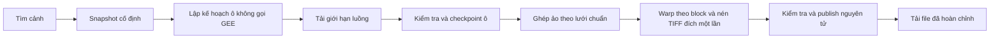

# Phương án tối ưu tải Sentinel-2/GEE

**Trạng thái:** đề xuất để duyệt; chưa triển khai. Phạm vi hiện tại chỉ viết tài liệu.
**Mục tiêu:** giảm thời gian từ bấm tải đến nhận GeoTIFF hoàn chỉnh, giữ nguyên dữ liệu và hỗ trợ tiếp tục các lượt tải lớn bị gián đoạn.

## 1. Bằng chứng và phạm vi

Đã đọc luồng đang có trong `app/main.py`, `app/imagery.py`, `app/raster_grid.py`,
`app/request_timing.py`, các worker time-series và matched-frame cùng kiểm thử raster lớn.

- `/api/download/{dataset}` chọn lại cảnh thay vì dùng nguyên kết quả `/api/scene`.
- `download_geotiff()` lập URL theo băng/ô, gọi URL kiểm tra rồi `discard()`;
  worker tạo URL lần nữa trước khi lấy pixel. Chuẩn bị URL ban đầu chạy tuần tự.
- `merge_band_tiffs()` đã tải song song 6 worker; `_fetch_with_retry()` trả toàn bộ
  `response.content`. Các vòng retry lồng nhau có thể kéo dài việc chờ.
- Tất cả các phần được tải xong mới ghép. Với rectangle, ghi/nén `.source.tif`,
  đọc lại, warp và ghi/nén TIFF đích; `FileResponse` chỉ bắt đầu sau đó.
- Chưa có timing từng pha của download. Timing 129,23 giây trong lần kiểm tra
  thumbnail gần nhất là thời gian tìm/chuẩn bị ảnh, **không phải benchmark tải**.
- ROI người dùng: tâm `106.4437867045,10.076415139`, rộng `83328.8399307535 m`,
  cao `76948.81987935984 m`, xoay `0°`, ngày `2023-01-18..2023-05-17` inclusive.
  Ước tính với cách chia hiện tại: 3×3 ô/băng, 108 phần khi xuất 12 băng;
  khoảng 216 lượt lấy URL và 108 GET pixel trong trường hợp không lỗi.
- Máy được kiểm tra: Core 5 210H, 8 core/12 logical CPU, khoảng 15,5 GiB RAM.
  Các con số tài nguyên dưới đây là cấu hình đề xuất, chưa phải kết quả benchmark.

Giai đoạn đầu áp dụng Sentinel-2 GEE điểm/chữ nhật, ảnh đơn và RAW. Các chế độ
khác tiếp tục dùng đường tương thích; không thay thuật toán median/medoid,
time-series, matched-frame, CDSE/AWS hay tự nâng giới hạn ROI/GEE.

## 2. Các hướng và lựa chọn đề xuất

| Hướng | Được gì | Giới hạn |
| --- | --- | --- |
| A. Tối ưu pipeline GEE đang có | Giữ workflow và output; bỏ xử lý lặp; dùng lại các phần đã tải | Vẫn chịu giới hạn interactive GEE và proxy |
| B. Đưa job nền/progress vào trước | Tránh gắn công việc dài với HTTP; phục hồi sau reload | Riêng job nền không làm GEE/warp chạy nhanh hơn |
| C. GEE batch Export sang Cloud Storage | Hợp với khối lượng vượt khả năng interactive | Cần bucket/quyền/cost; có hàng đợi, chưa chắc nhanh cho ROI nhỏ |

**Đề xuất:** triển khai A trước, bổ sung B trên cùng snapshot/checkpoint sau đó.
C là nhánh đánh giá riêng khi benchmark cho thấy interactive không còn phù hợp.
Không chọn tăng worker đơn thuần làm giải pháp chính.

## 3. Hợp đồng dữ liệu phải giữ

1. Giữ band order, Float32, scale/offset/unit/tags, pixel 0 hợp lệ và NoData từng băng.
2. RAW giữ mây, ưu tiên toàn bộ tập cảnh nền; cảnh bổ sung chỉ lấp dữ liệu gốc
   còn thiếu. Không sửa haze ranking, ngưỡng phủ ≥99% hoặc thứ tự các batch.
3. Giữ băng mã nguồn với mask nhị phân của bản sửa seam; không trộn mã cảnh.
   Các băng tại một pixel vẫn thuộc cùng nguồn, QA thiếu không lấy từ ngày khác.
4. CRS, affine, kích thước lưới đích, góc xoay, footprint và halo phải như hiện tại.
   Vẫn tải qua lưới WGS84 rồi xử lý local; không ép GEE nhận custom CRS của ROI.
5. Nội suy phổ bilinear và lớp phân loại nearest phải giữ; không bỏ lượt kiểm
   tra mask nearest hiện tại chỉ vì muốn nhanh hơn.
6. BigTIFF, ghi theo block và publish nguyên tử phải giữ. Không đọc cả ảnh vào RAM.
7. Không giảm băng, độ phân giải, đổi Float16/UInt16 hay nới kiểm tra để đạt tốc độ.
8. Giữ các API/link cũ; path tối ưu có cờ bật/tắt và đường tương thích rõ ràng.

## 4. Pipeline đề xuất

### 4.1 Snapshot kết quả tìm kiếm

Thêm `selection_token` vào response `/api/scene`; link GET cũ có thể mang token
để dùng snapshot mà không chọn lại cảnh. URL không token tiếp tục hành vi cũ.
Token sai/hết hạn trả lỗi rõ ràng, không âm thầm tìm cảnh khác.

Snapshot server lưu: request canonical, ROI/bbox/halo, output grid, bands/auxiliary,
platform/date, graph GEE đã serialize, graph digest, phiên bản xử lý, tất cả nguồn
đã chọn với full asset ID, thứ tự ưu tiên và lớp primary/fallback.
`SceneInfo.scenes` chỉ là nguồn đóng góp được hiển thị, **không đủ để dựng snapshot**:
ví dụ ROI này có 16 nguồn đã chọn nhưng chỉ 8 cảnh đóng góp khi đo.
Thu trace cục bộ lúc chọn nguồn; không chạy thêm vòng getInfo để dựng trace.

Không serialize mù `ee_object` rồi gọi đó là bất biến: nhánh single hiện có thể
giữ `collection.toList(...).get(index)`, nên catalog đổi có thể trả cảnh khác.
Sau khi chọn, dựng graph bằng full native asset ID trực tiếp (`Image.load`) và
recipe xử lý đã chốt; RAW dùng helper compose chung với đường tìm kiếm, giữ cả
source index và thứ tự ưu tiên, không sao chép thuật toán sang một bản thứ hai.
Preview cũng phải dùng graph đã bound này. Frozen graph không được còn selector
`ImageCollection.load/toList/first` phụ thuộc catalog. Snapshot cố định **lựa chọn**;
không hứa GEE không bao giờ cập nhật nội dung cùng asset ID. Ghi version nguồn
nếu provider có; phát hiện thay đổi version khi resume phải từ chối trộn cache.

Persist SQLite và graph trong `downloads/gee-downloads/`. Client chỉ nhận token,
không nhận graph, đường dẫn server, credential hay URL provider để dùng lâu dài.
Khôi phục graph bằng GEE SDK hiện có, không rerank. Snapshot hết hạn sau 24 giờ
cho job mới; job đã nhận phải giữ bản riêng đến khi kết thúc/hết retention.
Đổi request/bands/grid/platform hoặc phiên bản xử lý phải đổi fingerprint.

### 4.2 Tải ô, pooling, checkpoint

- Tách lập kế hoạch hình học khỏi lấy URL. Giữ quy tắc ô, thứ tự và sampling hiện
  tại trong bản đầu. Không đợi probe mọi ô rồi mới tải; tạo URL ngay trong worker.
- Ước tính byte/pixel có biên an toàn, kiểm tra metadata TIFF thực nhận. Có thể
  probe đại diện khi cần; không tạo và bỏ một URL cho mọi ô.
- Khởi điểm 6 request pixel đang hoạt động cho pipeline GEE, không phải 6 cho
  mỗi job. Giới hạn cả số future chờ: tối đa 2×số worker.
- Dùng Session riêng theo worker, đóng response/Session khi xong. Giữ TLS và
  trust bundle hiện có. Không chia sẻ một Session ghi trạng thái giữa các thread.
- Transport mới phải sở hữu cả OAuth, tạo resource thumbnail và GET pixel bằng
  REST session cô lập, theo mẫu `_RPC` hiện có; không gọi SDK `getDownloadURL()`
  trong worker vì SDK có shared Session/retry/deadline riêng. POST resource và
  GET pixel đều tính vào cùng ngân sách ô. Chuẩn bị graph tile bằng serializer
  hiện có ở local, không dùng RPC để lập kế hoạch. Không cần public signed URL.
- Stream chunk 1 MiB vào `.part`, kiểm tra TIFF/schema/grid/masks và checksum
  rồi rename thành ô hợp lệ. Header classic TIFF và BigTIFF đều được nhận.
- Chỉ phần đã kiểm tra được checkpoint. Resume kiểm tra fingerprint, SHA-256,
  grid, bands, dtype/nodata; file hỏng hoặc khác kế hoạch phải tải lại.
- Resume được bảo đảm ở **cấp ô hoàn chỉnh**. Không hứa HTTP Range/tiếp tục byte
  trong một URL GEE đã hết hạn; `.part` hỏng được tải lại từ đầu.
- Một ngân sách retry/deadline, không nhân các vòng 5×6: đề xuất tối đa 3 attempt,
  tổng 900 giây/ô, connect 15 giây, read tối đa 180 giây và không vượt thời gian còn lại.
  Backoff jitter, tôn trọng Retry-After, có kiểm tra pause/cancel giữa các chunk.
- 429/5xx/đứt kết nối được retry trong ngân sách. 401/403 GEE thật dừng để xử lý
  auth/quyền; HTML lỗi gateway đặc thù chỉ retry có giới hạn. URL lỗi/hết hạn
  được tạo lại khi cần. Không lưu URL tạm thành checkpoint.
- Tắt retry ẩn của HTTP adapter/AuthorizedSession; OAuth HTTP request phải nhận
  thời gian còn lại, có số lượt và log attempt có kiểm soát. Một attempt ô có
  thể gồm OAuth cần thiết, một POST resource và một GET; không nhân các tầng
  retry ngoài bộ điều khiển. Test phải cấm SDK getDownloadURL/getInfo/setDeadline
  trong worker. `_RPC.thumbnail_once()` là mẫu, không dùng nguyên phiên bản
  đang gom toàn bộ bytes vào RAM cho bước stream.
- Provider readiness/SDK initialization xảy ra riêng ở preparing, trước tile
  execution, đo và báo lỗi riêng; DownloadRPC constructor nhận credentials/project
  đã sẵn sàng và không gọi init_ee ngầm. Ngân sách900giây là của từng ô, không
  phải lời hứa giới hạn toàn job hoặc initialization. Không sửa timeout/retry
  process-global để thực hiện giới hạn của worker.
- Trước cả job nền, direct GET đã phải claim attempt/lease SQLite theo fingerprint.
  Hai request trùng không cùng ghi cache: request sau dùng artifact đã kiểm tra
  hoặc nhận409 download_in_progress. `.part` theo attempt riêng; tile đã kiểm tra
  dùng tên content-addressed và DB CAS chọn receipt. Worker cũ không overwrite
  receipt/metadata của attempt mới. Task job nền sau đó dùng chung cơ chế này.
- Bản đầu đóng băng tile layout; không tự chia lại ô sau khi đã tải một phần.
  Đổi layout tạo attempt/fingerprint mới. Các thử nghiệm đổi layout ở mục 7.

### 4.3 Bỏ TIFF trung gian có nén

Tạo VRT local từ các TIFF ô đã kiểm tra, rồi dùng `write_grid_band()`/WarpedVRT
ghi thẳng TIFF đích theo block. Chỉ nén TIFF đích một lần đối với rectangle.
Đây là ghép **ô vận chuyển của cùng ảnh GEE**, không ghép lại các cảnh Sentinel.

VRT phải sử dụng lưới chung và placements được neo toàn cục như
`_mosaic_placements()` hiện tại. Giữ fractional SrcRect và quy tắc làm tròn DstRect.
Nguồn first-valid của legacy phải thắng; không dùng mặc định last-wins của VRT
mà chưa đảo đúng thứ tự và xác minh mask/NoData. Chuẩn hóa sentinel/NaN đúng từng
băng; copy description/scale/offset/unit/tags. Không thêm dependency `osgeo.gdal`;
dùng Rasterio/GDAL đang có và XML từ standard library nếu phù hợp.

Điều kiện bật: với **cùng tile bytes**, masks và pixel Float32 hợp lệ phải bằng
bit-for-bit với legacy; categorical bằng tuyệt đối; grid/metadata tương đương.
Nếu chưa đạt, tiếp tục đường writer cũ và ghi rõ gate chưa đạt. Không giảm tiêu chí.
Vector mask và các chế độ khác chưa nhập vào fast path trong bản đầu.
VRT chỉ bật khi build GDAL/Rasterio hiện có hỗ trợ đúng mask semantics cần dùng;
không tự nâng minimum dependency hoặc nhận định runtime khác đã được kiểm.

### 4.4 Job nền và file đã hoàn tất

Sau khi A ổn định, thêm POST tạo job từ selection_token, GET trạng thái,
pause/resume/cancel và GET file hoàn chỉnh theo job ID. GET file chỉ phục vụ file,
không tạo job hay chạy GEE lại; hỗ trợ Range/206/ETag để trình duyệt tiếp tục tải.
HEAD chỉ trả metadata. Giữ lease artifact suốt thời gian gửi response, kể cả
Range/disconnect; cleanup TTL/quota không được xóa file đang được phục vụ.

State: queued → running → completed; running có stage preparing/downloading/
assembling/validating/publishing. Các nhánh paused/interrupted/failed/cancelled
được phân biệt. Restart chuyển job chưa xong thành interrupted; resume dùng
snapshot và ô hợp lệ, không tự tìm lại cảnh. Pause/cancel có hiệu lực tại ranh
giới chunk/block hoặc sau khi request hiện tại trả về/hết timeout.

Giữ job attempt counter/CAS để worker cũ không ghi trạng thái/publish cho lần
resume mới. Nếu pause lúc ghi TIFF, resume giữ ô đã tải nhưng chạy lại assembly;
không mặc định tiếp tục ghi một TIFF dang dở. Crash sau rename nhưng trước DB
completed phải được phục hồi bằng kiểm tra artifact, không publish mù.

UI dùng các nhãn chuẩn bị/tải dữ liệu/xử lý/hoàn tất; hiển thị phần đã tải và bytes,
không báo 100% toàn job khi mới tải xong input. Poll khoảng 1 giây khi đang chạy,
chậm lại khi tab nền; khôi phục job ID khi tải lại trang. Không đưa graph/worker
hay các chi tiết triển khai vào luồng người dùng.

### 4.5 Cache và ngân sách tài nguyên

Chia khóa cache thành ba tầng để đổi compression không làm tải lại pixel:

- `selection_hash`: graph digest, exact recipe/asset priority, pipeline version,
  provider scope, ROI/halo, grids, bands/order và nodata/resampling.
- `tile_key`: selection_hash + requested region/grid, band group, layout và wire
  schema. Không đưa writer/compression options vào khóa ô vận chuyển.
- `artifact_key` (export fingerprint): selection_hash + ordered tile plan digest
  + output grid + writer options. Đây là khóa chống hai export cùng ghi artifact.

Chỉ dùng lại ô/artifact đã kiểm tra. Claim của attempt/job pin snapshot trước khi
cleanup TTL; search hết hạn không được xóa graph mà attempt/job đang tham chiếu.

Giá trị khởi điểm đề xuất cho máy hiện tại:

| Mục | Giá trị để bắt đầu đo |
| --- | --- |
| Network worker | 6; thử tối đa 8 sau khi có baseline |
| Writer raster đang hoạt động | 1 |
| Thread nén | 2; thử 4 có kiểm soát, không ALL_CPUS mặc định |
| GDAL cache | 256 MiB; Rasterio Env truyền số byte đúng đơn vị |
| Warp memory | 64 MiB như hiện tại |
| RSS mục tiêu | ≤2 GiB với ROI 12 băng; ≤3 GiB với 26 băng trên máy 15,5 GiB |
| Reserve đĩa | legacy:3×logical bytes+2 GiB; VRT:2×logical bytes+2 GiB |

Limiter dùng chung giữa các **bulk export GEE**, tránh tích số worker theo số job.
Có admission FIFO một raster/scene đang xuất; cấp trước khi dựng deadline của
scene/ô/RPC. Giữ permit đến khi raster đó kết thúc, nhả giữa hai scene time-series,
không giữ qua cả năm. Network tối đa6 trong export được nhận; một writer hoạt động.
Không acquire lồng permit không reentrant. Preview/metadata tương tác dùng budget
riêng hiện có, không bị chặn sau một bulk raster; giới hạn6 này không được mô tả
là cap mọi request GEE của ứng dụng.

Queue wait đo riêng, có check pause/cancel. Job nền có thể ở queued; foreground
chờ tối đa900giây rồi trả queue_timeout rõ ràng. Không trừ queue wait vào900giây
scene của annual bằng cách đặt lock sau lúc deadline đã bắt đầu. Nếu caller đã
có absolute deadline thì phải tôn trọng remaining cho cả wait, không reset/kéo dài.
Tích hợp admission ở outer export trước timer, giữ thứ tự tìm/tải từng năm và
ngân sách provider cũ. Đây là một tiến trình local, không hứa distributed worker.
Không thay deadline GEE process-global.

Cache completed mặc định tối đa 32 GiB/72 giờ; checkpoint paused/interrupted tối
đa 7 ngày, có expires_at hiển thị. Không cleanup job đang chạy. Cleanup không
được xóa ngoài root quản lý hoặc xóa kết quả cũ khi attempt mới thất bại.

## 5. Đo lường và tiêu chí

Đo riêng: queue wait, resolve snapshot/search, planning/probe URL, create URL,
TTFB, transfer/verified bytes, retry, tile validation, merge/warp/compress,
final validation, publish và browser delivery. Phân biệt provider wait với
thời gian truyền; không suy ra tốc độ mạng chỉ từ thời gian toàn request.
Không log provider URL/token/credential; xuất report JSON/CSV theo job ID.

Baseline và A/B phải cùng input tile bytes cho phép đo local, cùng snapshot,
grid/bands máy/ổ đĩa cho live; ghi rõ cold/warm cache và không đo khi job lớn
khác đang chạy. Chạy local ít nhất 5 lượt, live ít nhất 3 lượt khi đủ điều kiện.
Không dùng mỗi thumbnail hoặc một ảnh nhỏ để tuyên bố tải nhiều GiB đã đạt.

Tiêu chí đề xuất, chưa được đo hay nghiệm thu:

- Bỏ được chọn cảnh lặp với token hợp lệ; cache ô hợp lệ tạo 0 GET pixel tương ứng.
- Bản tối ưu không còn probe-rồi-discard URL từng ô; retry vẫn giới hạn rõ ràng.
- VRT fast path không tạo full-size `.source.tif`, chỉ một lượt nén TIFF đích.
- Mục tiêu median thời gian local assembly giảm ≥25%, download end-to-end giảm
  ≥15% trên case lớn; case nhỏ không chậm quá 10%. Nếu GEE variance làm phép đo
  không kết luận được, báo chưa đủ bằng chứng, không tự hạ ngưỡng hoặc tuyên bố đạt.
- Tất cả gate dữ liệu, RAM, BigTIFF/atomic và seam phải đạt trước khi bật mặc định.

## 6. Bộ ca nghiệm thu

1. ROI nhỏ 2×2 km; point và rectangle có/không xoay.
2. ROI người dùng ở trên, 12 băng, RAW, cùng khoảng ngày; thêm xoay 15° để kiểm grid/halo.
3. Cùng ROI với 26 băng, gồm QA thiếu; không được đổi None/[] semantics.
4. HTTP đứt giữa chừng, URL hết hạn, 429, gateway HTML200, 401/403 thật, TIFF hỏng,
   restart, pause/resume nhanh, cache key đổi và thiếu đĩa.
5. Fractional tile origins, overlap, valid0, NaN/sentinel/hole; VRT-vs-legacy trên
   cùng bytes. Mask tuyệt đối giống; Float32 valid bitwise giống.
6. Live RAW seam: mask lẻ tạo label giả trước sửa; PNG ROI người dùng vẫn 0 khe
   trong suốt sau tối ưu; provenance và coverage giữ đúng.
7. Synthetic file **vật lý >4 GiB**, kiểm block cuối mọi băng và warp sau mốc4 GiB,
   có log RSS/đĩa/thời gian. Ghi rõ đây là local synthetic, không phải download vệ tinh.
8. Live một lượt tải toàn ROI lớn; nếu chưa chạy được thì gate live còn mở.

## 7. Để sau khi có baseline

- Thử 4/6/8 triệu pixel/ô, workers4/6/8 và DEFLATE mức1/3/6 với predictor3,
  ZSTD nếu build GDAL hỗ trợ. Kiểm dữ liệu trước khi so tốc độ; một biến mỗi lượt.
- Multi-band tile có thể bớt tính lặp graph, nhưng phải tính giới hạn32 MiB trên
  **tổng bands×pixels×bytes**; không hứa giảm request hay nhanh hơn nếu chưa đo.
- Batch Export→Cloud Storage là thiết kế/ủy quyền riêng; không tự tạo bucket,
  gửi dữ liệu ra tài khoản khác hay phát sinh chi phí trong kế hoạch này.

## 8. Điểm để người triển khai quyết định

Tên helper nội bộ và chi tiết XML/log được chọn theo coding style hiện có;
không được đổi các hợp đồng, defaults/gate hay tự mở rộng provider/phạm vi trên.
Phương án này là đề xuất, chưa phải chỉ thị thực thi hay kết quả tối ưu đã đạt.

## 9. Rà soát thiết kế

Builder check độc lập đã nêu các điểm cần chốt và bản này đã giải quyết:

- Serialize graph chứa `collection.toList(index)` chưa pin cảnh: yêu cầu direct
  asset binding và dùng cùng graph cho preview/download ở §4.1.
- Session pixel riêng chưa chặn retry/auth/URL của SDK: quy định DownloadRPC cô
  lập cả OAuth/POST resource/GET, kiểm thử cấm SDK network trong worker ở §4.2.
- Lock mới có thể ăn ngân sách deadline annual/frame: đặt admission trước timer,
  tách queue wait, giữ absolute deadline của caller ở §4.5.
- Direct GET cần chống ghi cache trùng trước khi có job UI: attempt lease/CAS và
  content-addressed receipt ở §4.2; các lớp khóa riêng được xác định ở §4.5.

Đây là các quyết định kỹ thuật đề xuất của người lập kế hoạch, không phải các
chỉ số đã benchmark hoặc lựa chọn đã được người dùng phê duyệt.
